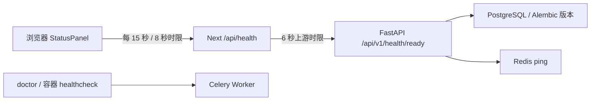

# A01：Playwright E2E 实现、逻辑分析与基础设施复验

日期：2026-11-04（Asia/Shanghai）。本次是 A01 补充，不实施 A02/A07 业务。用户新增长期要求：**以后每次更新前端都需要覆盖测试**。实施前计划见 [A01-e2e 计划](../plans/A01-e2e.md)。本报告集中记录检索、设计、缺陷、实现、测试与限制，旧 A00/A01 报告和原始证据保留历史状态。

结论：**PASS（本机 A01 CPU 基础设施与前端 E2E）**。前端统一门禁 42/0/0，真实浏览器 4/0/0，原 A01 基础设施复验 25/0/0，后端回归 21/0/0；所有最终命令 exit 0，浏览器 flaky/skip 均为 0。GPU/模型、Ubuntu 原生与远端 CI 运行结果不在此结论中。

## 1. 官方检索与选型

| 官方来源 | 对本项目的具体采用 |
|---|---|
| [Best Practices](https://playwright.dev/docs/best-practices) / [Locators](https://playwright.dev/docs/locators) | 从用户看到的标题、服务卡片和文案断言；使用 role/name 定位；每个测试独立 browser context，自动等待状态，避免依赖 DOM 层级和固定 sleep |
| [Web server](https://playwright.dev/docs/test-webserver) | 配置启动本地 HTTP fixture 和真实 Next standalone 生产服务；使用专用端口，reuseExistingServer=false，拒绝复用未知服务 |
| [Clock](https://playwright.dev/docs/clock) | 页面加载前安装/暂停浏览器时钟，精确推进 8 秒超时和 15 秒轮询；HTTP 仍真实异步执行，不等待真实 15 秒、不改生产轮询参数 |
| [Configuration](https://playwright.dev/docs/test-configuration) / [Trace viewer](https://playwright.dev/docs/trace-viewer) | 禁止 focused tests、零重试、失败 trace/截图、HTML 与 JSON 报告；失败直接阻塞门禁，不以重试掩盖 flaky |
| [CI](https://playwright.dev/docs/ci-intro) | push/PR 自动执行锁安装、浏览器安装、前端 verify、隔离 A01 实测；GitHub Actions 使用固定完整 commit SHA，权限 contents:read |

固定 `@playwright/test`、`playwright`、`playwright-core` **1.64.1**，锁定 Chromium **156.0.8078.4 / revision 1248**，npm 完整性记录在 package-lock。三个新增包均为 Apache-2.0，六份 LICENSE/NOTICE 与 SHA 见 [dependencies/licenses.json](../../evidence/A01-e2e/dependencies/licenses.json)。测试浏览器下载到用户缓存，不提交浏览器、视频或权重。原 A01 包清单不改写；本次只增加测试依赖，未升级 Next/React 或引入云模型。

## 2. 当前项目逻辑与信任边界



首页实际只有状态工作台，没有上传、视频播放器、分析或脚本入口。FastAPI ready 的数据库检查同时验证初始迁移版本及 installation；Redis 检查已在原 A01 修复长重试问题。live 不依赖数据库。Worker 独立由 inspect ping/doctor 监控，因此页面的 Redis 正常不代表 Worker 或模型成功；此边界继续在文案和测试中明确保留。

Next 代理只访问管理员配置的内部 API，不透传客户端 URL、凭据或任意上游字段。状态响应也是不可信数据，需要在代理和浏览器两端校验。当前合同是 A01 的 `models: not_configured`；A05 增加模型状态时必须同时调整接口合同、解析器和 E2E。

| 模块 | 原逻辑与问题 | 本次实现 |
|---|---|---|
| `app/status-panel.tsx` | 根据 status 字符串判断绿色；直接使用 JSON；仅卸载时 abort；固定 interval 可积累未完成请求 | 使用类型/状态合同；每次请求独立 AbortController、8 秒超时、inFlight 互斥、卸载清理；错误立即显示不可用；随后轮询恢复 |
| `app/api/health/route.ts` | 仅检查 status 是字符串、两个依赖是 boolean；HTTP 500 携带 ready 时仍透传 ready | 校验 HTTP 状态、status、code、dependencies、models 一致性；错误统一 503/不可用，丢弃底层错误体；显式 Cache-Control:no-store |
| `lib/health.ts` | 原来没有共享运行时合同 | 区分 FastAPI 与浏览器两种响应；200-ready 必须依赖全 true、API 可达；503-unavailable 必须至少一依赖 false；未知/矛盾数据安全降级 |
| 首页/样式 | 三张服务卡片、未配置模型提示、桌面三列/窄屏单列 | 保持业务布局，新增导航、刷新、窄屏溢出、状态可见性和人工截图检查 |
| 验收脚本 | 默认只针对日常 Compose 项目并写固定历史目录 | 新增可选 project/端口/output-dir；新入口建立独立测试实例、独立证据目录，最终停止自己的测试容器并保留卷 |

合法既有响应保持兼容，只收紧不合法响应。没有把未知数据“修正”为假成功，也不在浏览器展示原始私密错误正文。

## 3. 先失败、后修复的证据

前端基线来自上一次 A01 提交 `18d76770d351a71008537accc546d9c1c9652862` 的生产构建。先运行新负例取得失败，再修改健康逻辑并重新生产构建执行完整门禁。

- [baseline-proxy-negative.json](../../evidence/A01-e2e/baseline-proxy-negative.json)：原代理的“依赖 false 但 ready”“HTTP 500 + ready”两个用例均实际断言失败，exit 1。
- [baseline-ui-negative.json](../../evidence/A01-e2e/baseline-ui-negative.json)：原浏览器页面对应的矛盾依赖/HTTP 500 用例均实际断言失败，exit 1；无法找到“部分服务暂不可用”，原页面仍显示就绪。
- 首次浏览器尚未下载完时的两个启动失败单列在 [browser-bootstrap-failed.json](../../evidence/A01-e2e/browser-bootstrap-failed.json)，是缺浏览器可执行文件，**不算产品缺陷复现**。官方 CDN 下载曾断流，Playwright 自动重试后成功。上述 UI 负例是在浏览器安装完成后重新运行取得。
- 原实现的客户端无请求超时、无轮询互斥由代码检查确认；新增挂起/迟到响应回归验证修复后的边界，不把代码检查当成原实现真实超时测试通过。

## 4. 测试层次与场景覆盖

### A. 浏览器功能 E2E：30 项

真实 Next standalone 生产构建，健康响应由 Playwright 明确提供受控 fixture；每个场景分别在 Chromium 桌面和 Pixel 7 移动视口运行。

| 场景组 | 每视口数量 | 具体断言 |
|---|---:|---|
| 加载 | 1 | 首个响应到来前显示检测中，没有绿色就绪 |
| 正常、导航、刷新、布局 | 1 | 三卡片准确、模型未配置、无未实现上传按钮；首页链接/刷新后仍正确；无横向溢出，附整页截图 |
| DB 与 Redis 独立失败 | 2 | 页面部分不可用，API 卡片仍正常，失败依赖卡片明确不可用 |
| 不合法状态合同 | 7 | null、缺字段、错误 boolean、矛盾依赖、未知状态、HTTP 错误伪装 ready、API 不可达伪装 ready，全都不能显示绿色 |
| 网络失败与非法 JSON | 2 | 页面不崩溃、不显示上游原始错误正文 |
| 周期与恢复 | 1 | 14 秒不发第二次，15 秒发第二次；无须刷新即可从失败恢复 |
| 挂起与迟到响应 | 1 | 8 秒挂起超时、迟到旧响应不能重新显示绿色，下一轮恢复 |

总计 15×2=30。自动 fixture 还检查无未捕获浏览器异常、无外部浏览器 HTTP(S) 请求。移动视口是 Chromium 模拟，不是真实 Android 手机。

### B. Next 代理合同：12 项

实际 Next HTTP 路由调用专用 loopback HTTP fixture：正常 200、合法依赖失败 503、null、非法 JSON、未知状态、缺合同字段、矛盾 ready、500+ready、200+unavailable、错误 boolean、连接重置、上游挂起。挂起必须在约 6 秒返回 503，不展示底层正文。这是服务器合同实测，不是平台下载或数据库/模型成功证据。

### C. 真实浏览器与基础设施

专用 `video-analyzer-e2e` Compose project：前端 17810、API 17811、独立命名卷。浏览器健康请求不做 route/response fixture。真实访问生产镜像，并实际停止/恢复 PostgreSQL、Redis、API；观察页面在下一轮轮询展示不可用、前端 live 保持可用、恢复后自动回到正常。另执行已有 25 项基础设施验收（真实队列、迁移、三类持久化、数据层/接口故障、非 root 和日志检查）。

实际运行目录：[runs/20261104T070202Z](../../evidence/A01-e2e/runs/20261104T070202Z/)。[summary.json](../../evidence/A01-e2e/runs/20261104T070202Z/summary.json) 为 PASS；[playwright.json](../../evidence/A01-e2e/runs/20261104T070202Z/playwright.json) 记录真实浏览器 **4/0/0，flaky 0**；[infrastructure/acceptance.json](../../evidence/A01-e2e/runs/20261104T070202Z/infrastructure/acceptance.json) 为原有检查 **25/0/0**。所有构建、启动、验收、doctor、日志采集和 down 都在 commands.json 中，最终均 exit 0。

实际 Windows 11 x64，Node 22.23.1，Playwright 1.64.1、Chromium 156.0.8078.4；Docker Desktop 的 Linux amd64 应用容器，Engine 29.9.1 / Compose 5.6.0。主机 AMD Ryzen AI 9 365、10 核/20 线程、约 29.8 GiB RAM、AMD 880M，与原 A01 同一主机；GPU 未就绪，doctor 单独标 BLOCKED，基础服务 PASS。硬件来源见原 [A01 验收](A01-acceptance.md)，本次浏览器版本见 [browser-version.json](../../evidence/A01-e2e/browser-version.json)。

| 最终命令 | exit | 通过/失败/跳过 | 证据 |
|---|---:|---|---|
| `cd frontend; npm run verify` | 0 | **42/0/0**；同时 lint/TS/生产 build 通过，浏览器 flaky 0 | [frontend-verify-first.json](../../evidence/A01-e2e/frontend-verify-first.json)、[playwright-functional.json](../../evidence/A01-e2e/playwright-functional.json) |
| `python scripts/verify_a01_e2e.py` | 0 | 真实浏览器 **4/0/0** + 基础设施 **25/0/0** | 本节运行目录的 summary、playwright、infrastructure/acceptance、commands |
| `cd backend; uv run --frozen pytest -q` | 0 | **21/0/0**，一条已有弃用警告 | [backend-tests.json](../../evidence/A01-e2e/backend-tests.json) |
| 修改的 Python 脚本 Ruff 检查 | 0 | 静态检查通过 | [ruff-final.json](../../evidence/A01-e2e/ruff-final.json) |
| 验收后只更新日常实例前端镜像；`doctor.py --services` | 0 | 默认 3000/8000 服务可用，GPU 状态单列 | [local-frontend-refresh.json](../../evidence/A01-e2e/local-frontend-refresh.json)、[local-doctor.json](../../evidence/A01-e2e/local-doctor.json) |

本次受控测试耗时约 49 秒，真实浏览器约 29.8 秒；独立 Compose 构建约 183 秒。这是测试运行耗时，不是视频/模型性能指标。基础设施验收确实使用独立数据库及卷，清除了本次临时数据库/marker，finally 将隔离实例恢复后停止容器与网络，保留卷。日常实例没有参与故障注入；验收完成后只更新其前端镜像，供本机查看修复后的版本。

人工检查六张截图：桌面和移动视口均可读，三卡片按断点布局，无横向溢出；真实 DB/Redis 故障时 API 卡片仍正常，真实 API 停止时三卡片均不可用。模型未配置提示一直存在。截图来源明确：

- 受控正常页：[桌面](../../evidence/A01-e2e/screenshots/chromium-desktop.png)、[移动视口](../../evidence/A01-e2e/screenshots/chromium-mobile.png)。
- 真实实例：[正常](../../evidence/A01-e2e/screenshots/real-infrastructure-desktop.png)、[DB 停止](../../evidence/A01-e2e/screenshots/real-postgres-outage.png)、[Redis 停止](../../evidence/A01-e2e/screenshots/real-redis-outage.png)、[API 停止](../../evidence/A01-e2e/screenshots/real-api-outage.png)。

## 5. 持续测试门禁

已将用户要求写入根 [AGENTS.md](../../AGENTS.md) 第 13 条。所有前端更新必须：

1. 为受影响功能新增或调整成功与失败场景，测试变更和实现同批评审；覆盖指功能/异常场景，当前没有宣称代码行/分支覆盖率 100%。
2. `cd frontend && npm run verify`：ESLint → TypeScript → 生产 build → 全部 42 项受控 E2E/代理合同。禁止 only/skip/fixme 和固定 waitForTimeout；retries=0，flaky 视为失败。
3. 涉及健康合同/基础设施时执行 `python scripts/verify_a01_e2e.py`，证据按 UTC 时间创建新目录，不覆盖旧 A00/A01。CI 每次 push/PR 均运行此真实验收。
4. 失败修复后重新验证；环境不足则 BLOCKED。只有受控响应测试通过不能替代真实基础设施、平台或模型验收。
5. 审阅截图、HTML 报告和失败 trace；原始输出在 `.artifacts/playwright/`，默认不提交。CI 只归档当前合成状态页与脱敏基础设施证据，保留 7 天；未来出现账号/私有素材时需限制/脱敏 artifact，不能直接套用当前归档范围。

GitHub workflow 已配置固定 Action SHA（来源见 [ci-action-sources.json](../../evidence/A01-e2e/ci-action-sources.json)），仅 contents:read，checkout 不持久化凭据。远端分支保护/required check 属于仓库设置，本次没有擅自声称已配置；CI 文件存在也不等于某次远端 run 已通过。建议将 `frontend-e2e` 设为 required check，并限制直接绕过 main。

门禁另用 stdin 注入 skip、only、waitForTimeout 的故意违规样例验证，ESLint 按预期 exit 1，未改动任何源文件：[policy-negative.json](../../evidence/A01-e2e/policy-negative.json)。生产 standalone 镜像中不能 resolve `@playwright/test`，测试工具未进入生产运行时：[production-test-isolation.json](../../evidence/A01-e2e/production-test-isolation.json)。

## 6. 复现命令

```bash
cd frontend
npm ci --ignore-scripts --no-audit --no-fund
npx playwright install chromium   # Ubuntu 首次可增加 --with-deps
npm run verify
cd ..
python3 scripts/init_local.py
python3 scripts/verify_a01_e2e.py
```

Windows 使用 python 替换 python3。17800/17801 被占用时功能测试拒绝复用；已有隔离项目容器时真实验收拒绝抢占。测试会中断它自己的服务，finally 恢复后采集状态，再停止测试容器/网络，不删除用户数据卷。日常 3000/8000 实例与测试项目分开。缺浏览器时先安装，不把启动错误记成断言通过。

查看报告：frontend 目录执行 `npx playwright show-report ../.artifacts/playwright/functional-report`；失败 trace 用 `npx playwright show-trace <trace.zip>` 本地打开。HTML/trace 中可能含页面和网络数据，进入后续私有素材阶段须继续执行隐私规则。

## 7. 当前范围与未覆盖事项

- 本机 Windows 11 + Docker Desktop Linux amd64；Chromium 桌面及移动视口。Ubuntu 原生、Firefox/WebKit、真实手机未验证；CI 远端结果单列，不能提前宣称通过。
- 未部署或执行本地 VLM/ASR/OCR；无 NVIDIA GPU、模型权重或真实视频离线全链路证据。GPU/模型仍归 A05/A09，不阻塞本卡 CPU 基础设施判定。
- 当前首页无业务编辑/上传/鉴权；这些能力未来实现时必须补 E2E，不用当前状态页通过结果覆盖 A02/A07。
- 截图已经用于人工检查，当前不是跨系统像素基准回归；不同系统字体/DPR 有差异。没有设置自动接受快照来掩盖布局错误。
- npm 安装保留原有 ESLint 10 与部分插件声明范围的 peer 警告；本次实际 lint/build/浏览器已执行，未声明所有未来组合兼容。后端测试仍有一条原有 Starlette/httpx 弃用警告。
- 完整容器 OS SBOM、发布安全与备份恢复演练仍在后续任务范围，本卡没有发布产品或镜像。

## 8. 固定汇报

任务 ID：A01（E2E 补充）

范围与设计：官方检索；受控浏览器/代理合同 + 隔离真实 Compose 浏览器故障恢复；新增长期前端测试门禁。

变更文件：前端健康合同/轮询、Playwright 配置与 tests、package-lock、隔离验收脚本、AGENTS/README、CI、计划与本报告、新 evidence/A01-e2e。

测试命令、退出码、通过/失败/跳过数量：`npm run verify` exit 0，42/0/0，flaky 0；真实浏览器 4/0/0，基础设施 25/0/0，隔离脚本 exit 0；后端 pytest exit 0，21/0/0；Ruff exit 0。

真实验收证据路径（脱敏）：evidence/A01-e2e；旧 evidence/A00、evidence/A01 不改写。

已知缺陷、性能约束、未测事项：见第 7 节，模型/平台未验收，无代码覆盖率百分比承诺。

结论：PASS（本机 A01 CPU 基础设施与前端 E2E）；GPU/模型 BLOCKED、Ubuntu 原生及远端 CI 未验收，不构成产品发布验收。

下一任务建议：本卡全部验证完成后再评审 A02；以后每次前端更新执行上述门禁。
